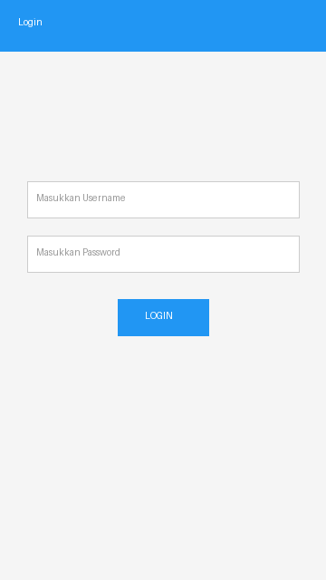

# Tugas Praktikum Pemrograman Mobile

* **Nama:** Mhd Fahri Irfandi Dewantara
* **NIM:** H1D024012
* **Shift Lama:** C
* **Shift Baru:** F

---

## 📌 Penjelasan Singkat Kode
Aplikasi ini dibangun menggunakan framework **Flutter** yang mencakup implementasi dari **Modul 2** dan **Modul 3** Praktikum Pemrograman Mobile:
* **Autentikasi Login:** Halaman login dengan input username & password (`admin` / `admin`).
* **Local Storage (SharedPreferences):** Menyimpan data nama pengguna (`username`) secara lokal di perangkat.
* **Side Menu / Drawer:** Navigasi menu samping untuk berpindah antar halaman (`Home Page` dan `About Page`).
* **Widget & Design Flutter:** Penggunaan widget dasar (`Column`, `Row`), form input data produk (`ProdukForm` & `ProdukDetail`), serta daftar produk (`ListView` & `Card`).

---

## 📸 Praktikum Flutter Screenshot

| Halaman Login | Halaman About Page | Halaman Sidemenu |
| :---: | :---: | :---: |
|  |  |  |
